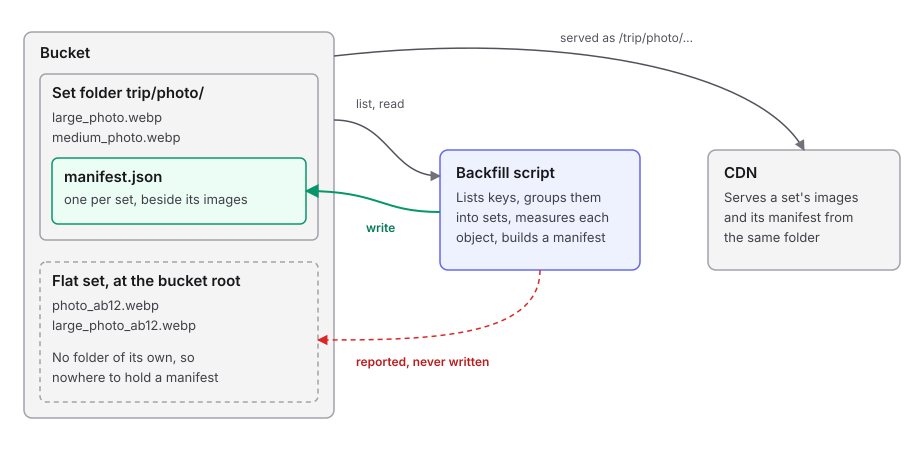
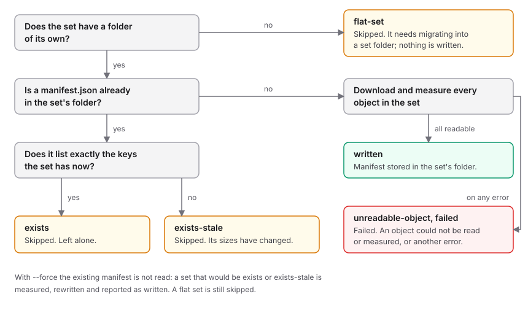

# Runbook: backfill manifests

Writes a manifest for every image set that was stored before uploads started writing their own. Run by hand from a checkout; it is not part of the deployed server.

- **Script:** `server/scripts/backfill-manifests.ts`, with its modules in `server/scripts/backfill/`
- **Reads:** one bucket per run (list and download only)
- **Writes:** one `manifest.json` per image set, inside that set's own folder in the same bucket, and only with `--write`
- **Safe to re-run:** yes. Existing manifests are left alone unless `--force` is given

## What it touches



A set's manifest is `<folder>/<name>/manifest.json`, or `<name>/manifest.json` for a set at the bucket root: always beside the images it describes. A `manifest.json` counts as a set's manifest only when an image of that set (`{variant}_{name}.webp` or `{name}.webp`) sits in the same folder; any other `manifest.json`, such as a web app's `data/manifest.json`, is an ordinary file the script ignores. The script never writes to an image key; the one function that stores a manifest refuses any key that is not `manifest.json` directly inside a non-empty folder, outside `src/`.

**Flat sets** (an un-prefixed file with prefixed copies beside it, in the bucket root or any folder, and no folder of their own) have nowhere to hold a manifest. The dry run counts and describes them so a bucket can be assessed; a write run reports each one as `flat-set` and writes nothing for it. They are moved into set folders by a separate one-off migration.

### How a consumer uses a manifest

- From an image URL, the candidate manifest is `manifest.json` in the same folder: `https://<cdn-host>/trip/photo/large_photo.webp` → `https://<cdn-host>/trip/photo/manifest.json`.
- It applies to that image only if the image's file name is the last path segment of one of the manifest's `variants.*.key`; otherwise there is no manifest for that image. A loose `trip/beach.webp` beside a set named `trip` is therefore not described by `trip/manifest.json`.
- Each `variants.*.key` is a bucket key. Resolve a variant by the last path segment of its `key`, in that same folder. A consumer never needs to know the bucket or how it is published.
- Do not infer a variant's format from its key; read `format`.

## Before you start

| Need | Why |
|---|---|
| `server/.env` with credentials that can list, read and write the bucket | The script uses the server's own S3 client |
| The region of the bucket, if it is not the server default | Passed as `--region` |
| The name of the bucket | It is an argument; nothing is hard-coded |
| A dry run you have read | A write run does not repeat the dry run's findings |
| The dry run's output saved to a file | Its `[set-manifest]` lines are the baseline of the manifests that existed before the run |

All commands run from `server/`.

## Arguments

| Argument | Meaning |
|---|---|
| `--bucket <name>` | Bucket whose image sets are read and, with `--write`, given manifests. Required |
| `--prefix <folder>` | Limit the run to one folder of the bucket |
| `--region <region>` | Region of the bucket. Defaults to the server's default region |
| `--write` | Measure every set and store its manifest. Without it the run is a dry run |
| `--force` | With `--write`, replace the manifest of a set that already has one |

## Procedure

Work through these in order. Stop at the first step whose result is not the expected one.

### 1. Dry run

```bash
bun --env-file=.env scripts/backfill-manifests.ts --bucket <bucket> [--prefix <folder>] 2>&1 | tee dry-run.log
```

| Line in the report | Expect | If not |
|---|---|---|
| `Keys listed` | Matches `aws s3 ls s3://<bucket>/<folder>/ --recursive \| wc -l` | The listing is incomplete; check credentials and region |
| `Sets by layout` | Nested sets only. A `flat` count above zero is followed by a note that each needs migrating | Flat sets get no manifest. Migrate them into set folders first, or accept that a write run skips them |
| `Skipped keys` | Files that are not images, folder markers, anything under `src/`, and one `set-manifest` line per set that already has a manifest. A `manifest.json` with no image of its set beside it is listed as `not-webp`, like any other file | An image you expected to see is listed here with the reason it was skipped |
| `Sets where two variant names share an ETag` | Informational. Older uploads stored one file under several names | Nothing to do; the manifest records what is there |
| `Sets missing medium or large` | Zero, or sets you know are small | Those sets get a manifest without those sizes |
| `Sets with jpg/jpeg/png members` | Informational. They are not WebP, so they get no manifest | Nothing to do |

### 2. Write one folder

```bash
bun --env-file=.env scripts/backfill-manifests.ts --bucket <bucket> --prefix <folder> --write 2>&1 | tee write-folder.log
```

Keep the log: its `[written]` lines are what the undo deletes. `tee` hides the script's exit code, so read `Failed` in the totals. Expect one line per set as it finishes, then totals:

```
[written] nested trip/photo -> trip/photo/manifest.json
...
Sets found: 12
Written: 12
Skipped: 0
  exists: 0
  exists-stale: 0
  flat-set: 0
Failed: 0
  unreadable-object: 0
  not-a-manifest: 0
  failed: 0
```

### 3. Check what was written

| Check | Command | Expect |
|---|---|---|
| Count | `aws s3 ls s3://<bucket>/<folder>/ --recursive \| grep -c '/manifest.json$'` | Equals `Written` plus `exists` plus `exists-stale` |
| Headers | `aws s3api head-object --bucket <bucket> --key <folder>/<name>/manifest.json` | `ContentType` `application/json`, `CacheControl` `public, max-age=300` |
| Through the CDN | `curl -sI https://<cdn-host>/<folder>/<name>/manifest.json` | `200`, `content-type: application/json` |
| Contents | `curl -s https://<cdn-host>/<folder>/<name>/manifest.json` | Every `variants.*.key` is in the set's folder with the same size; `width` and `height` match a file you open |
| Nothing else changed | `aws s3 ls s3://<bucket>/<folder>/ --recursive \| grep -v '/manifest.json$'` before and after | Identical |

### 4. Write everything

```bash
bun --env-file=.env scripts/backfill-manifests.ts --bucket <bucket> --write 2>&1 | tee write-all.log
```

The folder from step 2 shows as `exists`. `Failed: 0` and exit code `0` mean every set that can have a manifest has one.

## Arguments the script refuses

Each of these exits with code `1` before any request is made.

| You ran | It says | Why it is refused |
|---|---|---|
| No `--bucket` | `--bucket is required` | Nothing to read |
| `--prefix /` or an empty `--prefix` | `--prefix must name a folder without a leading "/"` | It would list nothing and look like a clean run |
| `--force` without `--write` | `--force only applies with --write` | A dry run replaces nothing |
| Any other unknown flag | The parser's error | Typos must not be ignored |

## Runs that stop early

| Situation | It says | Exit code |
|---|---|---|
| The bucket or folder has no keys | `No keys found in ...` | `1` |
| Keys exist but none form an image set | `No image sets in ...` | `1` |
| Credentials missing from the environment | The server's missing-keys error | `1` |

## What can happen to one set



| Outcome | Counts as | What it means | What to do |
|---|---|---|---|
| `written` | Written | The manifest was stored in the set's folder. A detail such as `lossless holds jpeg, not webp` means a file's bytes do not match its name; the manifest records the real format | Nothing |
| `exists` | Skipped | The set already has a manifest listing exactly its current files | Nothing |
| `exists-stale` | Skipped | The set has a manifest, but a size has been added or removed since. The line lists which keys | Re-run with `--force` to refresh it |
| `flat-set` | Skipped | The set has no folder of its own, so there is nowhere to store a manifest. The line says it needs migrating into a set folder | Migrate it, then run the backfill again; until then it has no manifest |
| `not-a-manifest` | Failed | The manifest key holds a file this service did not write: not JSON, no `schema: 1`, or `variants` that is not an object. It is read first even with `--force`, and never replaced | Look at the file. Move or delete it yourself if it is not wanted, then re-run |
| `unreadable-object` | Failed | An object could not be downloaded or is not an image, or its size differs from the listing | Check the key named in the line; re-run once it is fixed or removed |
| `failed` | Failed | Any other error for that set, including a request that timed out after 60 seconds | Read the message; re-run |

Any `Failed` count above zero makes the exit code `1`. Skips do not, so a bucket of only flat sets exits `0` having written nothing.

With `--force`, every nested set whose manifest is ours is measured and its manifest replaced. A file that is not a manifest is still left alone.

## When something goes wrong

| Symptom | Likely cause | Action |
|---|---|---|
| The run was interrupted | Closed terminal, lost network | Re-run the same command. Sets already written show as `exists` |
| Many `failed` lines mentioning a timeout | Slow or dropped connection | Re-run; only the failed sets are attempted again |
| `exists-stale` on sets you did not touch | Files were added or removed in the bucket after the manifest was written | Re-run with `--force` |
| A manifest is wrong | The set changed, or it was written by an older version | Re-run with `--force` and `--prefix <folder>` |
| The CDN still serves an old manifest | Manifests are cached for five minutes | Wait, or invalidate `/<folder>/*/manifest.json` on the CDN |
| Every set is `flat-set` | The bucket has not been migrated into set folders | Nothing was written. Migrate first |

## Undo

Undoing a run is deleting exactly the keys it wrote. Each `[written]` line of a write run's log ends in the manifest key it stored (`[written] nested trip/photo -> trip/photo/manifest.json`), so the log is the list. Nothing else was written. Do not delete by pattern such as `*/manifest.json`: that matches at any depth, and so also hits unrelated `manifest.json` files and manifests written by uploads.

Extract the keys from each write run's log and read them:

```bash
sed -n 's/^\[written\] .* -> //p' write-folder.log > written-keys.txt
cat written-keys.txt
```

Every line must be a `<folder>/<name>/manifest.json` key from this run. Preview the deletes, then run them:

```bash
while IFS= read -r key; do aws s3 rm "s3://<bucket>/$key" --dryrun; done < written-keys.txt
while IFS= read -r key; do aws s3 rm "s3://<bucket>/$key"; done < written-keys.txt
```

- Repeat for each write run's log. A set the run reported as `exists` or `exists-stale` has no `[written]` line, so its manifest is not touched.
- With `--force`, a `[written]` line can mean a manifest that existed before was replaced. Deleting it removes that manifest too; the dry run's `[set-manifest]` lines say which sets had one.
- To undo one set, name the object: `aws s3 rm s3://<bucket>/<folder>/<name>/manifest.json`.

Removing a manifest is safe for images: nothing but the manifest is deleted, and a consumer that finds no manifest falls back to its own behaviour. The set's name stays taken for uploads, because its images are still in the folder.

## Limits

- Every object is downloaded whole, four sets at a time. This suits buckets of a few thousand images; a much larger bucket needs ranged reads first.
- Only `.webp` files are grouped into sets. A set whose original is a `.jpg` or `.png` gets no manifest.
- Flat sets get no manifest until they are migrated into set folders.
