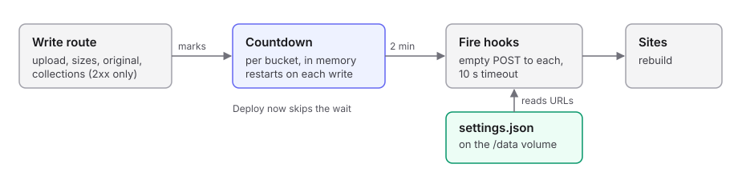

# Runbook: deploy hooks

Redeploys the sites that read a bucket when the bucket changes. The server keeps each bucket's hooks in a settings file and calls them after writes. Nothing here is run by a script; this page covers where the data lives and how to look after it.

- **Code:** `server/src/modules/settings/`
- **Reads and writes:** one JSON settings file, `SETTINGS_PATH` (default `/data/settings.json`), on the `s3-upload-settings` Docker volume
- **Calls:** each hook URL, with an empty `POST`
- **Safe to re-run:** yes. Pressing Deploy now twice just calls the hooks twice

## What it touches



- Every successful write the tool makes to a bucket restarts that bucket's countdown: uploads, size generation, attaching an original, and all collection writes. Reads, including requests for presigned URLs, never do.
- The hook fires once, two minutes after the last write. The countdown and each hook's last result live in memory only: a server restart drops a pending deploy, and Deploy now covers that.
- A failed call (a non-2xx answer, a timeout or a network error) is logged with the hook's name and shown as its last result. There are no retries.
- Hook URLs must be `https`. They are stored in the settings file as plain text, and the routes only ever return the host and the last 4 characters.

## Settings file

| Item | Value |
|---|---|
| Path in the container | `/data/settings.json`, or `SETTINGS_PATH` |
| Volume | `s3-upload-settings`, mounted at `/data` by `docker-compose.yml` |
| Shape | `{ "buckets": { "<bucket>": { "hooks": [{ "id", "name", "url" }] } } }` |
| Missing file | Read as no hooks; the first save creates it |
| Write | To `settings.json.tmp`, then renamed into place |
| Mode | `0600`, owned by the `bun` user |

The deploy workflow's `down` and `build` keep named volumes, so the file survives a redeploy. `docker compose down -v` deletes it.

## Inspect it safely

The file holds secret URLs: never `cat` it or paste it into a ticket. Print only the shape.

```bash
docker exec s3-upload-server bun -e '
const s = await Bun.file(process.env.SETTINGS_PATH ?? "/data/settings.json").json();
for (const [bucket, { hooks }] of Object.entries(s.buckets))
  console.log(bucket, hooks.map((h) => `${h.name} ${new URL(h.url).host}`));'
```

| Output | Meaning | If not |
|---|---|---|
| One line per bucket with hook names and hosts | The file is readable and valid | A parse error means the file is damaged: restore it from a backup |
| `ENOENT` | No hook has been saved yet | Nothing to do |
| `EACCES` | The volume is not writable by the `bun` user | See the problems table |

## Back it up

Copy the file out of the volume into a private location, and keep the copy as private as the URLs themselves.

```bash
docker cp s3-upload-server:/data/settings.json ./settings.backup.json
chmod 600 ./settings.backup.json
```

Never commit the copy or attach it to a ticket. To restore, copy it back and restart the server:

```bash
docker cp ./settings.backup.json s3-upload-server:/data/settings.json
docker restart s3-upload-server
```

## Problems

| Symptom | Cause | What to do |
|---|---|---|
| Saving a hook answers 500 and the log shows `EACCES` | The volume was created owned by root | `docker exec -u root s3-upload-server chown bun:bun /data` |
| A hook shows a red result with status 0 | The call timed out after 10 s or could not connect | Press Test; check the site's hook is still enabled |
| A hook shows a red result with a 4xx status | The URL was revoked or regenerated | Replace its URL in the settings page |
| A pending deploy vanished | The server restarted | Press Deploy now |
| The settings file is lost | The volume was removed | Add the hooks again, or restore the backup |

## Undo

- To stop a hook firing, delete it in the settings page, or remove its entry from the file with the server stopped.
- To remove everything, delete the file and restart: the server reads a missing file as no hooks.

## Planned

Moving the URLs out of the file and into AWS SSM Parameter Store (SecureString) is a follow-up. The routes stay the same, so the settings page will not change.
