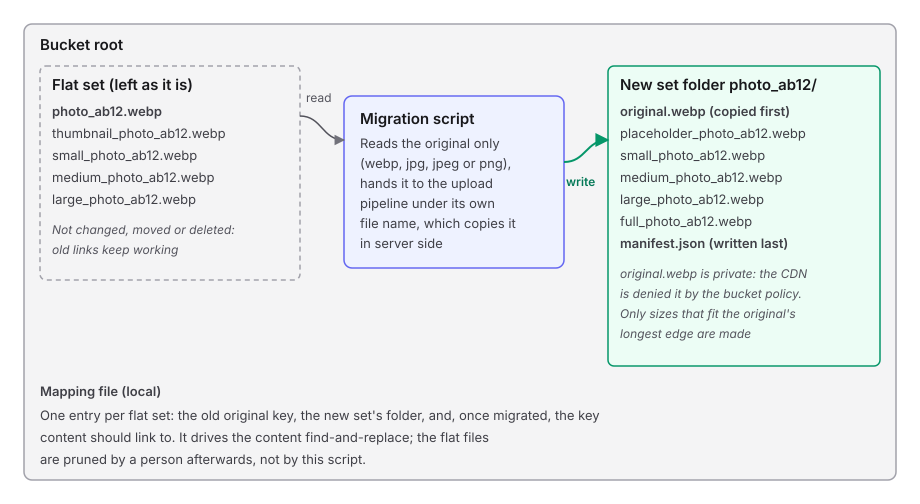

# Runbook: migrate flat sets into set folders

Turns every flat image set in a bucket into an ordinary set with a folder of its own, by putting the flat set's original through the same pipeline an upload uses. Run by hand from a checkout; it is not part of the deployed server.

**Temporary.** This script and this page are deleted once the migration is done and flat-layout support is removed (see issue #29, the cleanup).

- **Script:** `server/scripts/migrate-flat-sets.ts`, with its modules in `server/scripts/migrate/`
- **Reads:** one bucket per run: a listing, an existence check per flat set, and each migrated set's original
- **Writes:** only with `--write`, and only the upload pipeline's own puts into a new set folder (`<folder>/<name>/`): the current sizes, then `manifest.json`. Always writes the mapping file locally, never to the bucket
- **Never:** modifies, moves or deletes an existing object. A set whose new folder would hold a flat file is refused before anything is read
- **Safe to re-run:** yes. A set that already has its folder is reported as `already-migrated` and not touched

## What it touches



A **flat set** is what the old CMS left: an un-prefixed original such as `DSC_1963_f6f8bf29c4.webp` with prefixed copies (`thumbnail_`, `small_`, `medium_`, `large_`) beside it. For a flat original `<folder>/<name>.<ext>` the migration creates `<folder>/<name>/` (`<name>/` at the bucket root) exactly as an upload of `<name>.<ext>` to `<folder>` would. For example `images/spiderman_x.jpg` with `images/small_spiderman_x.jpg` beside it becomes `images/spiderman_x/`.

The original may be `.webp`, `.jpg`, `.jpeg` or `.png`. Non-WebP sets are found with the same grouping the backfill dry run uses for `Sets with jpg/jpeg/png members`, and the original is handed to the pipeline under its real file name and type. The pipeline still writes WebP variants, so `linkTo` is always a `.webp` key, while `original` keeps its real extension.

If two originals would map to the same set folder (for example `x.webp` and `x.jpg`), only the first is migrated: webp originals come before the others, then listing order. Each later one is reported as `unsafe-target`, naming both keys, and nothing of it is read or written.

## The mapping file

Always written, dry run included; by default `./flat-set-mapping.json` in the directory you run from. It is a JSON array with one entry per flat set that has an original, sorted by `original`:

```json
[
	{
		"original": "DSC_1963_f6f8bf29c4.webp",
		"setPrefix": "DSC_1963_f6f8bf29c4/",
		"linkTo": "DSC_1963_f6f8bf29c4/large_DSC_1963_f6f8bf29c4.webp",
		"outcome": "migrated"
	}
]
```

| Field | Meaning |
|---|---|
| `original` | The flat original's key: what site content links to today |
| `setPrefix` | The new set's folder, ending in `/` |
| `linkTo` | The key content should link to: `large`, otherwise `medium`, otherwise `small`; never the placeholder or the `full` file. `null` unless the set is `migrated` or `already-migrated` |
| `outcome` | Where `linkTo` came from. `migrated`: what the pipeline stored in this run. `already-migrated`: what the listing shows in the existing folder. Anything else (`to-migrate` included): `linkTo` is `null` |

Only drive the content find-and-replace from entries whose `outcome` is `migrated` or `already-migrated`. A dry run therefore has no links: its entries are `to-migrate` with `linkTo: null`, since which sizes exist depends on the original's longest edge and a dry run does not download originals.

## Before you start

| Need | Why |
|---|---|
| `server/.env` with credentials that can list, read and write the bucket | The script uses the server's own S3 client |
| The region of the bucket, if it is not the server default | Passed as `--region` |
| The name of the bucket | It is an argument; nothing is hard-coded |
| A copy of the bucket to run against first | The flat files stay put, but the new folders are real writes |

All commands run from `server/`.

## Arguments

| Argument | Meaning |
|---|---|
| `--bucket <name>` | Bucket whose flat sets are read and, with `--write`, given set folders. Required |
| `--prefix <folder>` | Limit the run to one folder of the bucket |
| `--region <region>` | Region of the bucket. Defaults to the server's default region |
| `--write` | Put each flat original through the upload pipeline. Without it the run is a dry run |
| `--limit <n>` | With `--write`, migrate at most `n` sets (failures count). For a trial run |
| `--map <file>` | Where to write the mapping file. Default `./flat-set-mapping.json` |

## Procedure

Work through these in order. Stop at the first step whose result is not the expected one. Keep the output of every write run (`| tee <file>.log`) and give each write run its own `--map`, so it can be undone.

1. **Dry run.**
   ```bash
   bun --env-file=.env scripts/migrate-flat-sets.ts --bucket <bucket> --map dry-run.json
   ```
2. **Trial with `--limit`.**
   ```bash
   bun --env-file=.env scripts/migrate-flat-sets.ts --bucket <bucket> --write --limit 1 --map trial.json | tee trial.log
   ```
3. **Check the trial set** (table below).
4. **Full run.**
   ```bash
   bun --env-file=.env scripts/migrate-flat-sets.ts --bucket <bucket> --write --map full.json | tee full.log
   ```
5. **Verify with the backfill dry run.**
   ```bash
   bun --env-file=.env scripts/backfill-manifests.ts --bucket <bucket>
   ```
6. **Check the missing sizes.** A size is left out only when the original's longest edge, `max(width, height)`, is shorter than it (`large` is 1440 px, `medium` is 800 px), so a set missing one with a longer `full` file is wrong. Prints one line per such set; no output is the expected result:
   ```bash
   jq -r '.[] | select(.outcome == "migrated") | .setPrefix' full.json | while IFS= read -r prefix; do
     aws s3 cp "s3://<bucket>/${prefix}manifest.json" - | jq -r --arg prefix "$prefix" '
       .variants as $v
       | ([$v.full.width, $v.full.height] | max) as $edge
       | select((($v.large == null) and ($edge >= 1440)) or (($v.medium == null) and ($edge >= 800)))
       | "\($prefix): full longest edge is \($edge) px but a size is missing"'
   done
   ```
   Repeat with `trial.json` if the full run did not cover the trial set.

### Expected results per step

| Step | Expect | If not |
|---|---|---|
| 1. Dry run | `Migration dry run: nothing is written to the bucket`, the number of keys and how long the listing took, one `[to-migrate]` line per flat set, `Failed: 0` | Read each `[unsafe-target]` or `[failed]` line before going on |
| 1. Dry run, `already-migrated` | `0` on a bucket never migrated | Something already uses those folder names; inspect them before writing |
| 2. Trial | One `[migrated]` line, the rest `[to-migrate]`; `Migrated: 1`; exit code `0` | Read the `[failed]` line; nothing else was attempted |
| 2. Trial, between result lines | The pipeline's own `||== ... ==||` progress lines for that set | Nothing to do |
| 3. Folder | `aws s3 ls s3://<bucket>/<setPrefix>` lists the sizes and `manifest.json` | See the outcomes table |
| 3. Sizes | Download the new `large_` (or largest) and `full_` files and measure them: `full_` has the original's width and height, or 3840 px on its longest edge when the original is larger; a portrait is still portrait | Undo the set and report it |
| 3. Flat files | `aws s3api list-objects-v2 --bucket <bucket> --prefix <name>` before and after: the flat keys have the same `Size`, `ETag` and `LastModified` | Stop: this must never happen |
| 3. Mapping | The trial entry is `migrated`, and its `linkTo` exists in the bucket | Do not use the file for content |
| 4. Full run | The trial set shows as `already-migrated`; `Failed: 0`; exit code `0` | Re-run; only sets without a folder are attempted again |
| 5. Backfill dry run | One nested set per migrated flat set, `Sets missing medium or large` lists only sets you know are small, the flat sets still listed | Compare against `full.json` |
| 6. Missing sizes | No output: every migrated set missing `large` has a `full` longest edge (`max(width, height)`) below 1440, and every one missing `medium` has one below 800 | Undo that set and report it |

## What can happen to one set

| Outcome | Counts as | What it means | What to do |
|---|---|---|---|
| `migrated` | Migrated | The pipeline stored the sizes and the manifest in the new folder | Nothing |
| `to-migrate` | Left to migrate | A dry run, or a write run that reached `--limit`. Nothing was read or written for it | Run without `--limit` |
| `already-migrated` | Skipped | Something is already stored under the new folder, by an earlier run or because the pipeline found it taken | Nothing; check the folder if this was not expected |
| `no-original` | Skipped | The set has no un-prefixed file to make the sizes from. The current classifier always finds one, so this should not appear | Look at the keys by hand |
| `reserved` | Skipped | The new folder would be under a path uploads are refused for (`src/`, `legacy/`) | Decide by hand where the set should go |
| `unsafe-target` | Failed | The new folder already holds a flat file, so the pipeline could replace it, or an earlier original of this run already claims the same folder. Refused before anything was read | Look at the keys named in the line; migrate by hand |
| `failed` | Failed | Any other error for that set: the original could not be read or decoded, or a request timed out | Read the message; re-run |

Any `Failed` count above zero makes the exit code `1`. One failed set does not stop the others.

## Runs that stop early

| Situation | It says | Exit code |
|---|---|---|
| No `--bucket` | `--bucket is required` | `1` |
| `--prefix /` or an empty `--prefix` | `--prefix must name a folder without a leading "/"` | `1` |
| `--limit` that is not a whole number above 0 | `--limit must be a whole number above 0` | `1` |
| `--limit` without `--write` | `--limit only applies with --write` | `1` |
| The bucket or folder has no keys | `No keys found in ...` | `1` |
| Credentials missing from the environment | The server's missing-keys error | `1` |

## Undo

Undoing a run is deleting the set folders it created. Use the mapping file of that write run, and only its `migrated` entries: those folders did not exist before the run. Never delete by a wildcard over the bucket: `*<name>*` also matches the flat files.

List the folders and read them. Every line must end in `/` and must not be a flat key:

```bash
jq -r '.[] | select(.outcome == "migrated") | .setPrefix' full.json > created-folders.txt
cat created-folders.txt
```

Preview, then delete. `--recursive` on `s3://<bucket>/<setPrefix>` only matches keys that start with that folder, and the script refused any folder that held a flat file:

```bash
while IFS= read -r prefix; do aws s3 rm "s3://<bucket>/$prefix" --recursive --dryrun; done < created-folders.txt
while IFS= read -r prefix; do aws s3 rm "s3://<bucket>/$prefix" --recursive; done < created-folders.txt
```

- Repeat for each write run's mapping file (`trial.json`, then `full.json`). An `already-migrated` entry in a later file was created by an earlier run, or was there before; undo it from the file of the run that reported it `migrated`.
- Keep the trailing `/` of each prefix; without it `photo` also matches `photo_2.webp`.
- The flat files are untouched by the migration, so undoing it changes nothing a site links to today.

## Limits

- Each migrated original is downloaded whole and re-encoded, four sets at a time.
- Anything sharp can decode would be accepted by the pipeline, but only `.webp`, `.jpg`, `.jpeg` and `.png` originals are looked for.
- With `--limit`, which sets are attempted depends on the order their existence checks return, so a trial picks roughly the first sets of the listing, not exactly.
