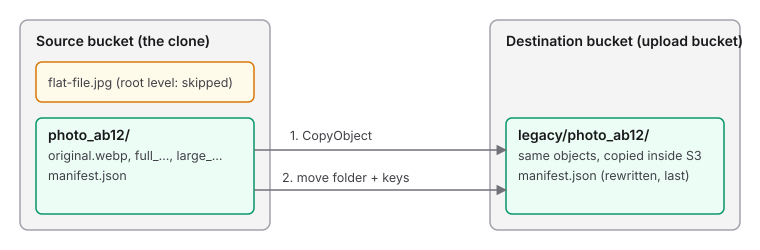

# Runbook: move the legacy sets into the upload bucket

Copies every set folder of the clone bucket (the migrated Strapi sets) into the upload bucket under the `legacy/` key prefix. The upload bucket is the CDN root, so every site path stays the same, and the clone bucket and its bucket-to-CDN-prefix mapping can then be retired. Run by hand from a checkout; it is not part of the deployed server.

- **Script:** `server/scripts/move-legacy-sets.ts`, with the manifest rewrite in `server/scripts/legacy/manifest.ts`
- **Reads:** a listing of the source bucket and, with `--write`, each set's `manifest.json`; a listing of the destination under `legacy/`
- **Writes:** only with `--write`, only into the destination under `legacy/`: a server-side copy of every object, then each rewritten `manifest.json`
- **Never:** changes the source bucket, or writes outside `legacy/` in the destination
- **Safe to re-run:** yes. An object already in the destination with the same size, and a manifest already there, are skipped

## What it touches



A **set** is a top-level folder of the source bucket: every object under it is copied to `legacy/<same key>` using S3's `CopyObject`, so the bytes never leave S3. Each copy is create-only and only of the version that was listed (its ETag). Files at the bucket root are not part of any set and are skipped, and counted in the report.

A set's `manifest.json` is written after the rest of its folder. It records the set's `folder` and the key of every image, so the copy moves them under `legacy/`: a root-level set's `folder` becomes `legacy` and a set inside `static-assets/` gets `legacy/static-assets`. The script refuses a manifest that is not one, or whose folder and name do not point at its new location. If any other object of its set failed, the manifest is not written.

## Before you start

| Need | Why |
|---|---|
| `server/.env` with credentials that can read the source and list, read and write the destination | The script uses the server's own S3 client |
| The names of both buckets | They are arguments; nothing is hard-coded |
| Both buckets in one region, passed as `--region` if it is not the server default | One region applies to both |
| A rehearsal bucket to run against first | The production run is a real write |

All commands run from `server/`.

## Arguments

| Argument | Meaning |
|---|---|
| `--source <name>` | Bucket the sets are copied from. Required |
| `--bucket <name>` | Bucket they are copied into. Required, and not the same as `--source` |
| `--prefix <folder>` | Limit the run to one top-level folder of the source |
| `--region <region>` | Region of both buckets. Defaults to the server's default region |
| `--write` | Copy. Without it the run is a dry run |

## Procedure

Stop at the first step whose result is not the expected one. Keep the output of the write run (`2>&1 | tee move.log`).

1. **Dry run.**
   ```bash
   bun --env-file=.env scripts/move-legacy-sets.ts --source <source-bucket> --bucket <bucket> --region <region>
   ```
2. **Trial on one set.**
   ```bash
   bun --env-file=.env scripts/move-legacy-sets.ts --source <source-bucket> --bucket <bucket> --region <region> --prefix <set> --write
   ```
3. **Check the trial set** (table below).
4. **Full run.**
   ```bash
   bun --env-file=.env scripts/move-legacy-sets.ts --source <source-bucket> --bucket <bucket> --region <region> --write 2>&1 | tee move.log
   ```
5. **Check every manifest.** Prints a line per bad manifest; no output is the expected result:
   ```bash
   mkdir manifests && aws s3 sync s3://<bucket>/legacy/ manifests --exclude "*" --include "*manifest.json"
   find manifests -name manifest.json | while read f; do
     jq -e '(.folder == "legacy" or (.folder | startswith("legacy/"))) and ([.source.key // empty, (.variants[].key)] | all(startswith("legacy/")))' "$f" > /dev/null || echo "bad: $f"
   done
   ```

### Expected results per step

| Step | Expect | If not |
|---|---|---|
| 1. Dry run | `Move dry run: nothing is written to the bucket`, the source key count and root-level files skipped, one `[ok]` line per set (every source manifest is read and validated, nothing is written), `Failed: 0`, `0 keys already there` on a first run | Read each `[failed]` line before going on |
| 2. Trial | One set `copied`, exit code `0`, `Count check` equal on both sides | Read the `[failed]` lines; undo the trial |
| 3. Folder | `aws s3 ls s3://<bucket>/legacy/<set>/` lists every object the source folder has | Undo and report it |
| 3. Manifest | `aws s3 cp s3://<bucket>/legacy/<set>/manifest.json -` has a `folder` starting `legacy` and keys starting `legacy/` | Undo and report it |
| 4. Full run | The trial set shows as skipped, `Failed: 0`, exit code `0`, and a `Count check` with the same number on both sides | Re-run; only what is missing is copied |
| 5. Manifests | No output, and the number of files found equals `Sets` | Undo that set and report it |

## What can happen to one object

| Outcome | What it means | What to do |
|---|---|---|
| Copied | Stored in this run (a dry run says `to copy`) | Nothing |
| Skipped | Already in the destination: same size, or a manifest | Nothing |
| Failed: exists with another size, or the source changed | The key is taken by something else, or the source object changed after the listing | Look at the destination key; delete it if it is stale, then re-run |
| Failed: not a set manifest, or folder and name do not match | The source `manifest.json` is not one this service wrote, or describes another place | Look at the source manifest; nothing of its set is described in the destination |
| Failed: not written, the set has failed objects | An earlier object of that set failed | Fix the failure above and re-run |

One failed object does not stop the others. Any failure, or a `Count check` that differs in a write run, makes the exit code `1`.

## Runs that stop early

| Situation | It says | Exit code | Action |
|---|---|---|---|
| No `--source` or no `--bucket` | `--source is required` / `--bucket is required` | `1` | Pass both |
| The two names are equal | `--source and --bucket must be different buckets` | `1` | Pass two buckets |
| The source has no keys | `No keys found in ...` | `1` | Check the bucket, region and `--prefix` |
| Credentials missing from the environment | The server's missing-keys error | `1` | Set the credentials in `.env` |

## Undo

Everything the run wrote is under `legacy/` in the destination, and the source is untouched. Delete the prefix, previewing first:

```bash
aws s3 rm s3://<bucket>/legacy/ --recursive --dryrun
aws s3 rm s3://<bucket>/legacy/ --recursive
```

Only do this when nothing else uses `legacy/` in that bucket. For one set, use `legacy/<set>/`.

## Limits

- Sets are copied four at a time, one object after another within a set.
- The report's counts are objects under the source's top-level folders. A run with `--prefix` counts only that folder on both sides.
